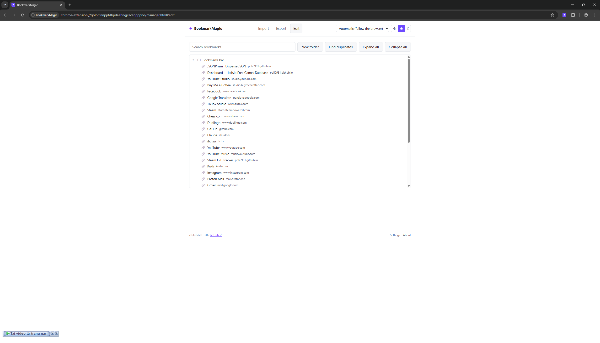
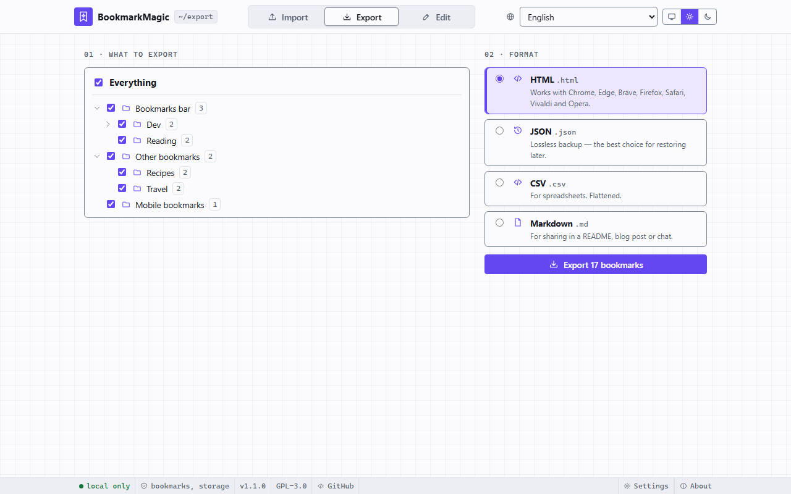
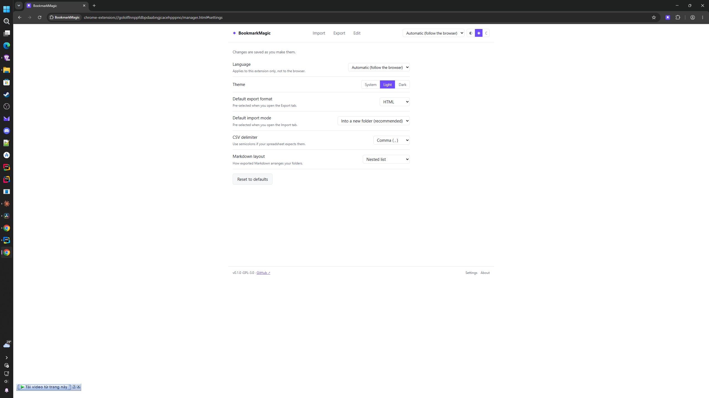
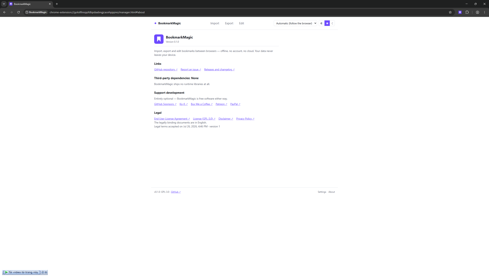

# BookmarkMagic

[](LICENSE)
[](https://github.com/poli0981/bookmarkmagic/actions/workflows/ci.yml)
[](https://github.com/poli0981/bookmarkmagic/actions/workflows/codeql.yml)
[](https://sonarcloud.io/summary/new_code?id=poli0981_bookmarkmagic)
[](https://sonarcloud.io/summary/new_code?id=poli0981_bookmarkmagic)
[](https://chromewebstore.google.com/detail/bookmarkmagic/eghnciphhegekmnofffpgbdfefckdhmg)
[](#privacy)

Move your bookmarks between browsers the simple way: with a file. No account,
no cloud sync, 100% offline.

A Chrome (MV3) extension for importing, exporting and editing bookmarks and
folder trees. English · Tiếng Việt · 日本語.

## Screenshots

| Edit | Export |
|---|---|
|  |  |

| Settings | About |
|---|---|
|  |  |

## What it does

- **Import** HTML, CSV and JSON bookmark files — including Chrome's own
  `Bookmarks` file from the profile folder and Firefox's JSON backups, the
  copies you have when a browser will not start. A full preview comes first:
  counts, folders, depth, duplicates and warnings before anything is written.
- **Choose how**: into a new dated folder (the safe default), merged into the
  folders you already have (reused, not copied), or replacing everything.
  Replace tells you exactly what it will delete, saves a JSON safety backup
  first, and **deletes nothing until that backup is proven** — and restoring
  that backup puts the Bookmarks bar, Other and Mobile bookmarks back where
  they were.
- **Export** everything, or just the folders you pick, to HTML (Chrome, Edge,
  Brave, Firefox, Safari, Vivaldi, Opera), JSON, CSV or Markdown.
- **Edit** the tree: search, rename, drag to move or reorder, sort a folder
  A→Z, create folders, delete, and find duplicate links — every action
  reachable from the keyboard.

## Privacy

This is the whole point of the project, so it is worth being precise.

- **No network access at all.** Not analytics, not telemetry, not update pings.
  There is no server. The browser enforces it: the extension's content security
  policy sets `connect-src 'none'`, so Chrome itself refuses any request an
  extension page tries to make. On top of that, `npm run check:manifest` scans
  the shipped bundle for network APIs and `npm run guard` scans the source.
- **Exactly two permissions**: `bookmarks` and `storage`. No host permissions,
  no content scripts, no background worker. Two gates enforce it: a unit test
  over `wxt.config.ts`, and `npm run check:manifest`, which CI runs against the
  **built** `manifest.json` — because a build can add what the config never
  asked for.
- **Zero runtime dependencies.** Nothing is installed at runtime; the only
  third-party code in the package is what the build compiles in — the Svelte
  runtime and WXT's one-line browser shim, both MIT
  ([`legal/THIRD_PARTY_NOTICES.md`](legal/THIRD_PARTY_NOTICES.md)).
- A short diagnostics log (error codes and counts, never titles or addresses)
  lives in memory while a tab is open, so you can copy it into a bug report.
  It never leaves your computer unless you paste it somewhere.
- Settings use `chrome.storage.local`, never `storage.sync`, so even your
  preferences stay off any vendor cloud.

Full policy: [`legal/PRIVACY.md`](legal/PRIVACY.md).

## Honest limitations

- Favicons cannot be imported — the bookmarks API has no favicon field.
- Imported bookmarks get today's date. Chrome does not let an extension set a
  bookmark's original creation date. Your **exported** files keep the real ones.
- CSV is a flattened view: empty folders and "which folder is the toolbar" are
  not preserved. Use HTML or JSON for a faithful backup.
- Markdown is share-only — BookmarkMagic cannot read it back.

## Install

From the Chrome Web Store: [here](https://chromewebstore.google.com/detail/bookmarkmagic/eghnciphhegekmnofffpgbdfefckdhmg)

Requires Chrome 136 or later (April 2025), or any Chromium browser of the same
vintage — Edge, Brave, Vivaldi, Opera. On an older browser the store keeps the
version you already have and simply stops updating it.

From source (Node.js 26):

```bash
npm ci && npm run build
```

Then load `.output/chrome-mv3/` at `chrome://extensions` with Developer mode on.

## Development

```bash
npm run dev
```

`npm run verify` is the gate everything else answers to — lint, type-check
(svelte-check on the TypeScript 6 API, then `tsc` 7), knip, the grep gate and
the test suite, in that order. It must be green before every commit;
`npm run verify:full` adds coverage, the build and the built-manifest check,
and must be green before anything release-bearing.

`node scripts/screenshots.mjs` serves the built extension with sample
bookmarks and a fake `chrome`, for looking at every page without loading the
extension (`--shoot` also captures the store screenshots).

The [`docs/`](docs/) directory is the binding specification, not notes: where
code and docs disagree, the docs win. Start with [`CLAUDE.md`](CLAUDE.md), then
`docs/00`–`docs/02`.

## Contributing

Bug reports and translation fixes are welcome —
[the issue forms](https://github.com/poli0981/bookmarkmagic/issues/new/choose)
ask for what is needed, and none of them requires you to write code.

If a bookmark file will not import, that is the most useful report there is,
because the sample becomes a permanent test. Sanitize it first:

```bash
node scripts/sanitize-bookmarks.mjs your-bookmarks.html
```

That strips every address and title but keeps the structure, encoding and
timestamps a parser bug depends on — so the sanitized file still reproduces the
problem without handing over your browsing history.

[`CONTRIBUTING.md`](CONTRIBUTING.md) has the rest: the setup, the rules that are
not negotiable, and how a reported file becomes a regression test.

Security issues: please follow [`SECURITY.md`](SECURITY.md) rather than opening
a public issue.

## Contact

| For | Write to |
|---|---|
| Security vulnerabilities (if you have no GitHub account) | security@poli0981.dev |
| Privacy questions, removing a sample you sent | privacy@poli0981.dev |
| The terms (EULA, disclaimer) | legal@poli0981.dev |
| Licensing and permission questions | copyright@poli0981.dev |
| Formal copyright (DMCA) notices | dmca@poli0981.dev |
| A copy or listing pretending to be BookmarkMagic | takedown@poli0981.dev |
| Contributing and code of conduct | code@poli0981.dev |
| Sponsorship · collaboration · press | sponsor@ · collab@ · press@poli0981.dev |

Bugs and feature ideas are best as
[issues](https://github.com/poli0981/bookmarkmagic/issues) — they help the next
person too. The extension itself never shows or uses any of these addresses.

## Support development

Entirely optional — BookmarkMagic is free software either way.

[GitHub Sponsors](https://github.com/sponsors/poli0981) ·
[Ko-fi](https://ko-fi.com/skullmute) ·
[Buy Me a Coffee](https://www.buymeacoffee.com/skullmute) ·
[Patreon](https://www.patreon.com/skullmute) ·
[PayPal](https://paypal.me/DungDang212)

## Licence

Copyright © 2026 skullmute ([poli0981](https://github.com/poli0981)).
[GPL-3.0-or-later](LICENSE). Also see [`legal/EULA.md`](legal/EULA.md),
[`legal/DISCLAIMER.md`](legal/DISCLAIMER.md) and
[`legal/THIRD_PARTY_NOTICES.md`](legal/THIRD_PARTY_NOTICES.md). Licensing
questions: copyright@poli0981.dev.

The BookmarkMagic name and icon identify this project. The GPL lets anyone fork
the code; it does not let a fork present itself as this project.

Not affiliated with or endorsed by Google, Chrome, Mozilla, Firefox or any
browser vendor. Browser names are trademarks of their respective owners.
